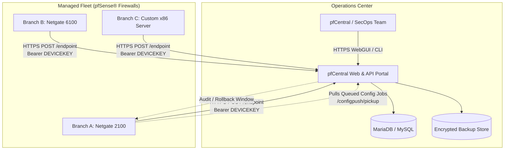

# pfCentral — Centralized pfSense® Firewall Management Platform

[](LICENSE)
[](https://www.php.net/)
[](https://codeigniter.com/)
[](https://pfcentral.microninfo.com/)
[](tests/)

**pfCentral** is a self-hostable, centralized management, telemetry monitoring, and desired-state configuration platform designed specifically for distributed fleets of **pfSense®** firewalls and Netgate® appliances.

Manage 5, 50, or 500+ branch firewalls from a single, unified operations pane deployed on infrastructure you control—ensuring complete sovereignty over your network configurations, credentials, and operational telemetry.

---

## The Problems pfCentral Solves

Managing multi-site pfSense firewalls at scale traditionally suffers from critical operational friction:

1. **GUI sprawl & repetitive manual updates**: Logging into dozens of web interfaces individually to push rules or update configurations is error-prone and time-consuming.
2. **Configuration drift**: When an engineer edits a local firewall GUI or reverts a snapshot, centralized teams are left blind until an outage occurs.
3. **Fragile backup storage**: Backups stored locally on firewalls or emailed in plaintext risk data loss or security exposure during hardware failure.
4. **Third-party cloud exposure**: Many commercial tools require firewalls to phone home to proprietary vendor clouds, creating supply-chain risks and compliance bottlenecks for regulated industries.
5. **No rollback or canary pipeline**: Pushing a faulty XML fragment or rule change fleet-wide can isolate entire branch offices instantly.

**pfCentral solves this with a self-hosted, declarative configuration delivery pipeline, automated disaster recovery packages, and continuous agent-driven drift verification.**

---

## Key Capabilities & Verified Features

### 1. Fleet Inventory & Real-Time Telemetry
- **Centralized Dashboard**: Live visibility into WAN IP, gateway latencies, CPU/memory/disk utilization, active WireGuard tunnels, and pfSense software release versions.
- **Agent Heartbeat Protocol**: Lightweight FreeBSD agent (`agent.sh`) checking in securely over HTTPS via per-device random cryptographic secrets (`DEVICEKEY`), eliminating predictable credentials.
- **Interactive Map & Topology**: Geographic location mapping and visual network topologies detailing hub-and-spoke tunnels and OSPF/BGP gateway statuses.

### 2. Desired-State Config Push Pipeline (`/configpush`)
- **Declarative Job Execution**: Push XML fragments, full configuration replacements, or vetted management scripts.
- **Canary Deployments & Phased Rollouts**: Target a canary branch before fanning out to regional or core clusters.
- **Two-Person Approval Workflow**: High-risk changes and script executions require second-administrator approval.
- **Automated Rollback & Drift Detection**: Detects post-deployment modifications and alerts administrators via email and dashboard notifications.

### 3. Fleet Configuration Search & Auditing (`/configsearch`)
- **Instant Full-Text & XPath Querying**: Search across the stored `config.xml` snapshots of your entire fleet simultaneously. Query subnets, IPsec peers, DNS overrides, or firewall aliases in milliseconds.
- **Compliance & CVE Matrix (`/compliance`)**: Track pfSense versions against known CVE advisories and record mitigation notes across all appliances.

### 4. Automated Backup & Disaster Recovery (`/pfsense/viewbackup`)
- **Versioned Backups**: Automatically pull daily, timestamped `config.xml` backups into secure, isolated storage.
- **Side-by-Side Visual Diff**: Compare any two backup versions with syntax-highlighted visual diffs.
- **One-Click DR Package**: Download a complete Disaster Recovery bundle with credentials, certificates, and configuration XML ready for cold-spare hardware provisioning.

### 5. Link Availability & Flap Detection (`/availability`)
- **Per-Branch Link Monitoring**: Dedicated uptime tracking across multi-WAN interfaces (MPLS, WireGuard, Internet).
- **Flap Detection**: Automatically flag unstable links flapping within defined threshold windows.
- **Reporting & Exports**: Export compliance reports in CSV, XLSX, and PDF formats.

### 6. Role-Based Access Control (RBAC)
- **Granular Permissions**: Built-in roles (`superadmin`, `admin`, `operator`, `viewer`) powered by CodeIgniter Shield.
- **Active Directory / LDAP (Optional)**: Support for enterprise corporate directory authentication with safe local fallback.

---

## Architecture Overview



---

## Quick-Start: 1-Command Self-Hosting

### Option A: Docker Deployment (Recommended)

Clone the repository and launch pfCentral with MariaDB in seconds:

```bash
git clone https://github.com/pfcentral/pfcentral.git
cd pfcentral
docker-compose up -d
```

Access the portal at `http://localhost:8080/login` (or your server's IP address).

### Option B: Bare-Metal Installation (Ubuntu / Debian / RHEL / Windows)

#### 1. System Requirements
- **PHP**: 8.2 or 8.3 with extensions: `curl`, `intl`, `mbstring`, `mysqli` (or `sqlite3`), `xml`, `openssl`, `zip`.
- **Database**: MariaDB 10.5+ / MySQL 8.0+ or SQLite 3.
- **Web Server**: Apache (`mod_rewrite` enabled) or Nginx.

#### 2. Setup Database & Environment
```bash
git clone https://github.com/pfcentral/pfcentral.git
cd pfcentral
cp .env.example .env
```

Configure your database connection in `.env`:
```ini
CI_ENVIRONMENT = production
app.baseURL = 'https://pfcentral.yourdomain.com'
database.default.hostname = localhost
database.default.database = pfcentral
database.default.username = pfcentral_user
database.default.password = your_secure_db_password
database.default.DBDriver = MySQLi
```

#### 3. Run the 1-Command Installer
```bash
php spark pfcentral:install
```
This automated command will:
1. Verify system prerequisites and PHP extensions.
2. Ensure directory permissions (`writable/`).
3. Execute all database migrations and base schema definitions.
4. Seed generic demonstration groups, locations, and device profiles.
5. Create your initial primary administrator account.

---

## Development Mode & Mock pfSense Device Simulator

pfCentral includes a dedicated **Mock pfSense Device Simulator** so developers and engineers can test telemetry, backups, and config pipelines without physical firewall hardware:

```bash
# Ingest mock telemetry & generate a valid pfSense config.xml backup
php spark pfcentral:mock-device --device=1 --mode=all

# Test branch link outage simulation
php spark pfcentral:mock-device --device=2 --status=down --latency=120ms
```

### Running Automated Tests
```bash
composer test
# or directly:
php vendor/phpunit/phpunit/phpunit --no-coverage
```

---

## Disclaimer

pfCentral is developed primarily for our internal business infrastructure and operational requirements. While it may be useful to other organizations, it may not suit every business environment, network architecture, or operational scenario without modifications.

Every organization has unique infrastructure, security policies, network designs, and compliance requirements. Customization, configuration, and thorough testing may be necessary before deploying pfCentral in another environment.

Users are responsible for evaluating suitability, ensuring proper configuration and security, and testing the solution before production deployment.

Support & Customization: Support for third-party deployments is not included by default. For customization, deployment assistance, bug fixes, or dedicated support, please visit [pfcentral.microninfo.com](https://pfcentral.microninfo.com/) or contact us with your requirements and relevant issue details. Requests will be reviewed, and the scope, feasibility, and applicable charges will be communicated before work begins. Support is provided only when explicitly agreed upon.

Limitation of Liability: pfCentral is provided "as is", without warranties of any kind. To the extent permitted by applicable law, the developers shall not be liable for damages, data loss, service interruptions, or security incidents arising from its use or inability to use.

More Information: For project details, customization options, deployment assistance, and other enquiries, visit [https://pfcentral.microninfo.com](https://pfcentral.microninfo.com/).

Thank you for your interest in pfCentral!

---

## Documentation

- [Installation Guide](INSTALL.md)
- [System Architecture](docs/architecture.md)
- [Self-Hosting Guide](docs/self-hosting.md)
- [pfSense Agent Installation & Rollout](docs/pfsense-agent-setup.md)
- [Mock Device Simulator Guide](docs/mock-devices.md)
- [Backup & Disaster Recovery Procedures](docs/backup-restore.md)
- [Security Guidelines & Threat Model](docs/security.md)
- [Troubleshooting & Diagnostics](docs/troubleshooting.md)

---

## Commercial Services, Consultancy & MSP

Need dedicated engineering support, custom driver integration, or a fully Managed Service Provider (MSP) model for your network infrastructure?

- **Custom Development**: Proprietary SIEM, webhook, or ITSM system integration.
- **Managed Firewall Operations**: 24/7/365 telemetry monitoring, scheduled firmware updates, and change management.
- **Enterprise Consultancy**: pfSense HA CARP clustering, multi-site WireGuard/IPsec mesh architecture, and security hardening reviews.

Visit **[pfcentral.microninfo.com](https://pfcentral.microninfo.com/)** or email **[contact@microninfo.com](mailto:contact@microninfo.com)** for service scoping.

---

## License

pfCentral is licensed under the **Apache License, Version 2.0**. See the [LICENSE](LICENSE) file for the complete license text.

*pfSense® is a registered trademark of Electric Sheep Fencing, LLC. pfCentral is an independent open-source project and is not affiliated with, sponsored by, or endorsed by Netgate, Rubicon Communications, or Electric Sheep Fencing, LLC.*
