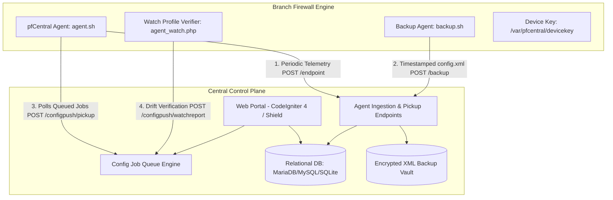

# pfCentral System Architecture

## 1. Architectural Philosophy

pfCentral operates on three foundational principles:

1. **Self-Hosting & Data Sovereignty**: All firewall configurations, cryptographic secrets, network topographies, and audit logs remain strictly on customer-controlled infrastructure. No telemetry is shared with external SaaS vendors.
2. **Declarative Desired-State Delivery**: Rather than pushing imperative, unstructured SSH commands that can leave devices in mixed or broken states, pfCentral models configuration changes as declarative, versioned jobs with pre-execution diffs and post-execution verification windows.
3. **Decoupled Asynchronous Telemetry**: Branch firewalls initiate communication inward to pfCentral over standard HTTPS (`POST /endpoint`), removing the requirement to expose pfSense administrative WebGUIs or SSH ports directly to the public internet.

---

## 2. Core Components

### Component Breakdown
- **Web Interface**: Clean, responsive UI with server-rendered views and asynchronous polling for real-time fleet health.
- **Agent Endpoint (`/endpoint`)**: Ingests structured XML telemetry from remote appliances, updating device availability, interface statuses, memory/disk metrics, and active tunnels.
- **Backup Receiver (`/backup`)**: Receives automated daily or on-demand `config.xml` snapshots, validates XML schema integrity, and writes versioned snapshots to the isolated backup directory.
- **Config Agent Pickup (`/configpush/pickup`)**: Enables appliances to pull assigned configuration jobs securely over HTTPS.
- **Watch Reporter (`/configpush/watchreport`)**: Compares active device configuration against the expected desired-state hash following change windows to detect drift.

---

## 3. Authentication & Credential Architecture

Authentication in pfCentral is tiered by caller type:

| Caller | Channel | Authentication Mechanism | Storage |
|---|---|---|---|
| Web Administrator | Browser Session | CodeIgniter Shield Session + CSRF Token | `auth_identities`, `users` |
| pfSense Firewall | Hourly Telemetry | `DEVICEKEY` Header or XML Body | `pf_inventory.devicekey` |
| pfSense Backup Runner | Daily Backup Push | `DEVICEKEY` Header | `pf_inventory.devicekey` |
| Config Agent | Job Pickup & Report | HMAC-SHA256 Request Signature | `device_agents.device_key` |
| WireGuard Uptime Probe | Telemetry Webhook | Pre-Shared Token | `core_config` / Environment |

Device keys are 32-byte cryptographically random hex strings generated directly on the FreeBSD appliance during installation.
